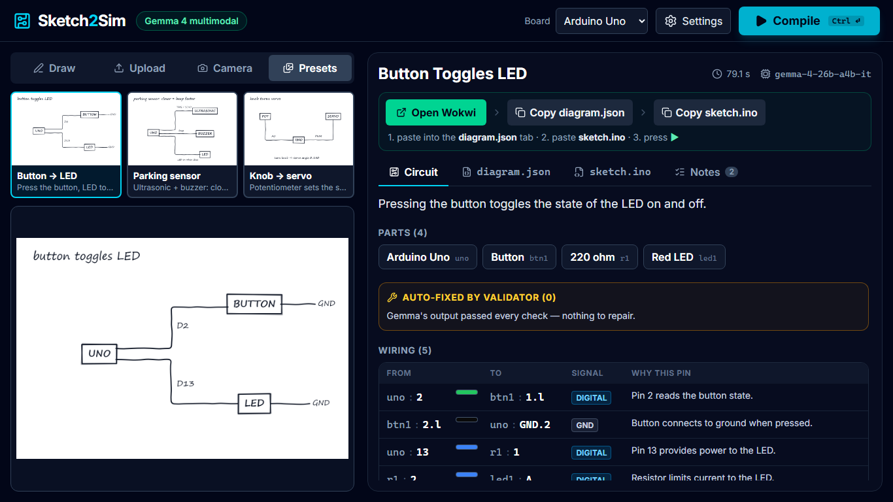

# Sketch2Sim

**From a paper sketch to a running circuit.**

Sketch2Sim turns a rough hand-drawn circuit (drawn in the app, or a photo of paper) into a ready-to-paste
Wokwi `diagram.json` + Arduino `sketch.ino`. **Gemma 4** reads the image; a **deterministic validator**
repairs whatever the model gets wrong, so the output is a circuit the real
[Wokwi](https://wokwi.com) simulator accepts. Paste both files, press ▶, press the button, the LED lights.

**Try it:** https://glatinone.github.io/sketch2sim/ (bring your own free Gemini API key; presets work without one and are labeled CACHED).

Built in one afternoon at **MLH Hacktoberfest Hack Day Batam** (31 Oct 2026) for the
*Best Use of Gemma 4* and *Best Open-Source AI Project* challenges.



<sub>Real screenshot of a live compile (gemma-4-26b-a4b-it, no mock).</sub>

## How it works

```
 sketch / photo ──► Gemma 4 (multimodal) ──► validator + repair ──► diagram.json + sketch.ino ──► Wokwi ▶
   canvas, upload,     reads boxes, labels,     catalog-locked parts,     ready to paste
   camera, presets     lines → parts + pins     pin aliases, resistors,
                       + firmware (JSON)        PWM/analog rules, GND
```

1. **Input:** draw on the canvas (pen, eraser, text, and part *stamps*: UNO, LED, BUTTON, BUZZER, SERVO, POT,
   ULTRASONIC), upload a photo (auto-resized to 1280 px), snap it with the webcam, or pick a preset.
2. **Gemma 4** (`gemma-4-26b-a4b-it` by default, editable) gets the image plus a part catalog and returns
   JSON: parts, wires with a rationale per pin, and Arduino firmware.
3. **Validator:** the model is never trusted blindly. Every part is mapped onto a fixed catalog of real
   Wokwi parts, pin names are normalised (`D13` → `13`, `GND` → `GND.1`), LEDs get 220 Ω series resistors,
   reversed polarity is swapped back, servos move to PWM pins, serial pins 0/1 are avoided, and missing
   GND/5V wires are added. Each repair is shown in the
   UI as an **"Auto-fixed by validator"** chip. Details: [`src/engine/ENGINE.md`](src/engine/ENGINE.md).
4. **Wokwi:** *Open Wokwi* opens a fresh Arduino Uno project; *Copy diagram.json* and *Copy sketch.ino*
   put each file on the clipboard. Paste, press ▶.

**Honest by design:** if the live API is down, presets fall back to a result saved from an earlier real
Gemma 4 run, and the UI marks it with a loud amber **CACHED** badge.

Supported parts today (Arduino Uno): LED, resistor, push button, buzzer, potentiometer, servo,
HC-SR04 ultrasonic sensor, DHT22.

## Run it locally

```bash
git clone https://github.com/glatinone/sketch2sim && cd sketch2sim
npm install
npm run dev            # http://localhost:5173
```

Open **Settings** (top right), paste a free Gemini API key from
[aistudio.google.com](https://aistudio.google.com/apikey), then draw something and press **Compile**
(or `Ctrl+Enter`). The key stays in your browser's localStorage and is sent only to Google's Gemini API.

A live compile takes ~30 s (longer when the free tier is busy).

Useful URL flags: `?mock` uses a built-in mock result (UI work without a key).

### Test the engine from the command line

```bash
node scripts/run-engine.ts public/presets/blink-button.png
```

## Project layout

```
src/
  contract/types.ts      the frozen interface between the UI and the engine
  engine/                Gemma 4 client, prompt, Wokwi part catalog, validator/repair, diagram + firmware builders
  compileClient.ts       the one switch between mock and real engine
  components/            TopBar, SketchCanvas, ImageInput (Draw/Upload/Camera/Presets), Result* panels
  ui/                    drawing model, image helpers, settings, mock, preset sketches
public/presets/          the three demo sketches (generated from src/ui/presetSketches.ts)
tools/gen-presets.*      re-render the preset PNGs with headless Edge/Chrome (needs `npm run dev`)
```

## Presets

| Preset | Parts | Behaviour |
|---|---|---|
| `blink-button` | UNO, BUTTON, LED | the button toggles the LED |
| `parking-sensor` | UNO, ULTRASONIC, BUZZER, LED | closer → faster beeps |
| `servo-pot` | UNO, POT, SERVO | the knob sets the servo angle |

The preset images are drawn with the same stamps and pen the app offers, so they look like real user input.

## Built with

- **Gemma 4** via the Gemini API (vision + reasoning)
- React 19, TypeScript, Vite, Tailwind CSS v4, lucide icons
- [Wokwi](https://wokwi.com) as the simulator target (no Wokwi code is bundled; you paste into wokwi.com)

### AI tools disclosure

This project was built with **[Claude Code](https://claude.com/claude-code)** (Anthropic): two Claude Code
sessions worked in parallel, one on the engine (Gemma client, prompt, validator) and one on the app (UI,
presets, docs). A human (Kiell) planned the split, reviewed and demoed it. Gemma 4 is the model the app
itself uses at runtime.

## Contributing

Good first issues are listed in [CONTRIBUTING.md](CONTRIBUTING.md): ESP32 target, more parts, Arduino UNO Q
App Lab export, a Bahasa Indonesia UI, Wokwi share links.

## License

[MIT](LICENSE)
